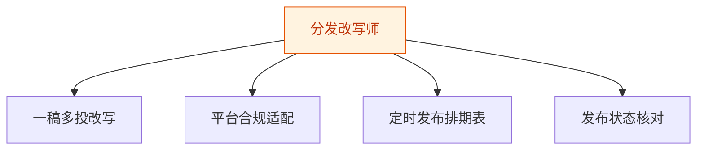

# 分发改写师 — 工作流流程图

本员工共 **4 条工作流**，下辖 **6 个原子技能**。

## 总览

## 分条详情

### 一稿多投改写

| 项目 | 内容 |
|------|------|
| 触发 | 人工（成稿后） |
| 复杂度 | `S` |
| 阶段 | `P1` |
| ROI | 分发 1-3h→30min，月省约 30-60h×¥30≈¥900-1800 vs ¥20-50 |

### 平台合规适配

| 项目 | 内容 |
|------|------|
| 触发 | 事件（WF1 后自动） |
| 复杂度 | `S` |
| 阶段 | `P1` |
| ROI | 规避因格式/敏感词导致的限流返工 |

### 定时发布排期表

| 项目 | 内容 |
|------|------|
| 触发 | 定时（每周） |
| 复杂度 | `S` |
| 阶段 | `P1` |
| ROI | 排期混乱与撞车归零 |

### 发布状态核对

| 项目 | 内容 |
|------|------|
| 触发 | 定时（每日收尾） |
| 复杂度 | `S` |
| 阶段 | `P1` |
| ROI | 防漏发/错发，矩阵运营刚需 |

## 汇总表

| # | 工作流 | 阶段 | 复杂度 | 触发 | 涉及技能数 |
|---|--------|------|--------|------|-----------|
| 1 | 一稿多投改写 | `P1` | `S` | 人工（成稿后） | 3 |
| 2 | 平台合规适配 | `P1` | `S` | 事件（WF1 后自动） | 3 |
| 3 | 定时发布排期表 | `P1` | `S` | 定时（每周） | 1 |
| 4 | 发布状态核对 | `P1` | `S` | 定时（每日收尾） | 1 |

---

*本图由 build_p0_assets.py 自动生成*
